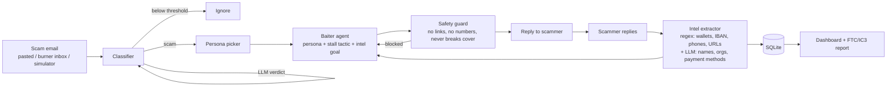

# 🎣 Scambaiter

**An AI agent that wastes scammers' time so they can't spend it on real victims, and collects the intel needed to shut them down.**

*ForgeHacks 2026 · AI + Cybersecurity track*

## The problem
AI has made scams cheap to run at scale: one scammer can send thousands of convincing, personalized messages. Most defenses only **block** messages, which costs the scammer nothing; they just move on to the next target. In 2024 the FTC recorded over $12.5B in reported fraud losses, and older adults lose the most per victim.

## The solution
When you get a scam, forward it to Scambaiter. It:
1. **Detects** the scam with explainable rules (gift cards, urgency, lookalike domains like `paypa1`) combined with an LLM judgement.
2. **Engages** it as a believable, gullible persona (Margaret, 78, retired librarian, who can never quite find the gift card aisle).
3. **Stalls** with a rotating set of tactics while steering the scammer into revealing **where the money goes**: wallets, bank accounts, phone numbers, websites.
4. **Reports**: it builds a ready-to-file report for the FTC / FBI IC3 with all collected intel and the full transcript.

Every message a scammer writes to Margaret is a message they're not writing to someone's real grandmother.

## Demo
```
python -m venv .venv
.venv\Scripts\activate          # macOS/Linux: source .venv/bin/activate
pip install -r requirements.txt
copy .env.example .env          # add your Featherless key (optional)
uvicorn app.main:app --reload
```
Open http://localhost:8000 → click **Demo: prize lottery** → **Auto-run 4 turns**.

No API key? It still runs in **offline fallback mode** (rule-based detection + template replies), so the demo never breaks.

## Architecture



| Component | File | What it does |
|---|---|---|
| Classifier | `app/classifier.py` | Noisy-OR over 16 weighted rules + link analysis (lookalike brands, IP links, shorteners, high-abuse TLDs), blended 60/40 with an LLM verdict |
| Personas | `app/personas.py` | 4 fictional personas matched to scam type (romance → Gloria, crypto → Dave, invoice → Kevin) |
| Baiter agent | `app/baiter.py` | Each turn gets a stall tactic and an **intel goal** (what we still haven't extracted, highest value first) |
| Safety guard | `app/safety.py` | Hard filter on every outgoing message; failed replies are regenerated, then fall back to safe templates |
| Intel extractor | `app/intel.py` | Regex for BTC/ETH/TRON wallets, IBANs, accounts, routing numbers, phones, URLs, Cash App tags + LLM for claimed identities |
| Simulator | `app/simulator.py` | An adversarial scammer agent for testing and demos (all its details are fake) |
| Live inbox | `app/inbox.py` | Optional IMAP/SMTP polling of a burner inbox |

**"Scammer minutes wasted"** is an estimate per message: 1 min overhead + reading our reply (~200 wpm) + typing theirs (~40 wpm).

## Ethics & safety
Scambaiting is deception, so the guardrails are part of the design:
- **Only confirmed scams are engaged.** Below the threshold the bot stays silent; in live mode, borderline cases wait for human approval.
- **Never gives data**, real or fake-but-realistic: no card numbers, accounts, links or long numbers ever leave the bot (enforced in code, not just the prompt).
- **No hostility:** no threats, insults, hacking back or doxxing. Intel goes to authorities, not the public.
- **Identity isolation:** use a burner address; personas are fictional.
- **Email only:** phone recording has consent laws, so voice is out of scope.
- Simulated threads are labeled and their reports say not to file them.

## Configuration
See `.env.example`. Any OpenAI-compatible endpoint works (`LLM_BASE_URL`, `LLM_MODEL`); the default is Featherless.

Modes:
- `INBOX_MODE=manual` (default): paste scams in, copy the bot's replies out from your burner account.
- `INBOX_MODE=imap`: auto-polls a burner inbox. To use a different provider such as Agentboxd, implement `fetch_new()` / `send()` in `app/inbox.py`.

## Tests
```
pytest -q
```
21 tests cover detection on sample scams, false positives on normal email, lookalike-domain detection, intel extraction, the safety filter (including that every fallback reply passes it), and a full API demo flow.

## What's next
- Agentboxd inbox integration so users get a one-click forwarding address
- Auto-submission of intel to wallet blocklists / registrar abuse desks
- Shared intel across users: the same wallet seen in 50 threads is a high-priority takedown
- Voice persona for phone scams (with consent-law handling)
